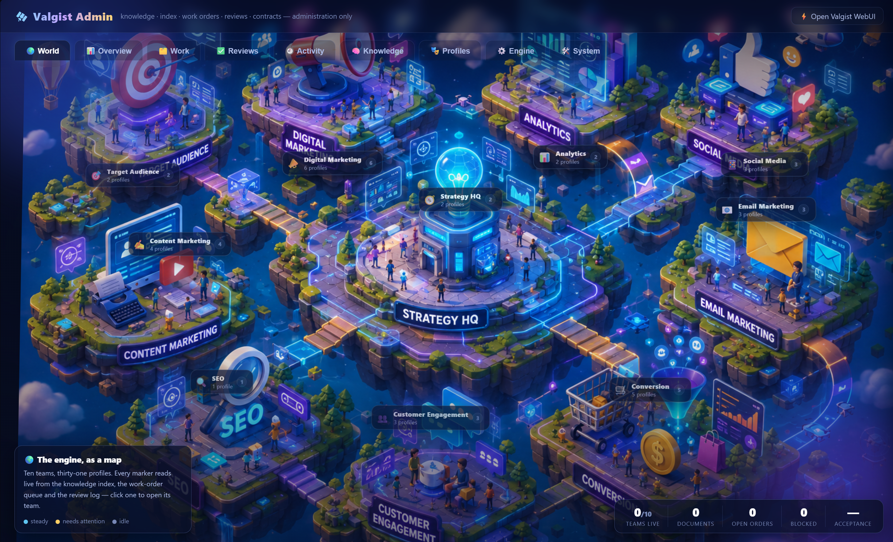

# Valgist — AI Marketing Engine

**A complete Marketing AI Engine you run yourself.** Spin up 31 specialist
marketing agents — from SEO and paid social to lifecycle email, CRO, and brand
strategy — that share one brand-aware knowledge base and work the way a real
marketing team does. Self-hosted, model-agnostic, and open source.



*The Valgist Admin **World** view: ten teams, thirty-one specialists, drawn live
from what the engine is actually doing. Click an island to open its team.*

*(Your team gets its own version of this — the 🌍 **office** in the chat front
end, which is where they start their day. See [The end-user seat](#the-end-user-seat-webui-8787).)*

---

## Why it exists

Most "AI marketing" tools are a single chatbot with a clever prompt. Real
marketing is a **team** of specialists who share context: the SEO lead reads
the same Brand Kit the copywriter does, the analyst reports on what the paid
team shipped, and everyone files their work somewhere the rest of the org can
find it.

Valgist gives you exactly that — a coordinated team of agents, each with a
defined role, playbooks, and output contracts, all reading from and writing to
a **single shared organization knowledge base**. Nothing lives in a vendor's
cloud. You own the data, the model choice, and the outputs.

## What you get

- **31 specialist agents, not one generic bot.** Each has a real persona, named
  playbooks, executable skills, a context recipe, and a contract for what it
  produces and where it files it.
- **A shared, brand-aware knowledge base with a retrieval layer.** A generated
  `INDEX.md` catalogues everything the organization knows; every agent reads it
  first, so work extends what exists instead of duplicating it.
- **A read-only organization brain.** Brand, research, playbooks and the
  org constitution are mounted read-only into the chat container — enforced by
  the kernel (and verified by a container write-probe), not by a prompt.
  Changes go through review and promotion.
- **An admin portal that actually administers.** The dashboard's **Engine** tab
  sets the default LLM, pins any agent to its own model, wires extra brain
  documents into any agent's context, toggles the compliance gate, and
  overrides routing — all applied live, no restart, no CLI.
- **Work orders, not lost hand-offs.** Routed work becomes a file with an
  owner, an output path and checkable acceptance criteria, so it survives the
  chat session that created it.
- **Quality signal, not vanity metrics.** Accept / revise / reject each output
  with a cause; the scorecard reports acceptance rates and the weekly retro
  turns recurring causes into repo changes.
- **Honest about what it can reach.** No integration ships wired. Agents never
  state platform numbers as fact — they ask you for an export, cite the file,
  and mark the rest `[AWAITING DATA]`.
- **Secure by default.** Both apps bind to localhost until you say otherwise;
  token auth, a login password and a scoped promotion token are one `.env` edit
  away.
- **Tested architecture.** `npm run eval` runs 55 offline checks — registry
  integrity, skills, routing, guardrails, the office map, and repo/container
  consistency.
- **Self-hosted in two containers.** One command brings the stack up. Your
  knowledge base is plain Markdown on your own disk.

## The team

All 31 agents are installed — no tiers, no upsells.

| Funnel stage               | Specialists                                                                                                                                                                                                                                                               |
| -------------------------- | ------------------------------------------------------------------------------------------------------------------------------------------------------------------------------------------------------------------------------------------------------------------------- |
| **Acquisition** (14) | Market Researcher · SEO Engine · Content Writer · Social (Organic) · Paid Search · Paid Social · PR & Communications · Influencer Manager · Affiliate & Partnerships · Podcast & Audio · Event & Webinar · ABM Engine · Video Marketer · Localization Engine |
| **Conversion** (6)   | Copywriter · Landing Page Builder · CRO Optimizer · Lead Gen & CRM · Product Marketer · E-commerce Marketer                                                                                                                                                          |
| **Retention** (5)    | Email Lifecycle · Marketing Automation · Reputation Manager · Community Manager · SMS Messaging                                                                                                                                                                       |
| **Operations** (6)   | Brand Strategist · Marketing Director · Analytics Engine · Compliance Guard · Creative Designer · Budget Planner                                                                                                                                                     |

Each agent is defined in `hermes/profiles/*.profile.md` — persona, playbooks,
skills, tools, integrations, the context it loads, the folders it owns, and its
output contracts — so you can read exactly what any specialist does.

## Quick start

You'll need [Docker Desktop](https://www.docker.com/products/docker-desktop/).

1. **Add your API key.** Copy `.env.example` to `.env` next to
   `docker-compose.yml` and set:

   ```
   ANTHROPIC_API_KEY=sk-ant-...
   ```

   Everything else in that file is optional.
2. **Start the stack.**

   ```bash
   docker compose up --build -d
   ```

   (On Windows, `bin/valgist.cmd` gives you `Valgist Dashboard` / `Valgist Stop`
   as terminal commands that do this for you.)
3. **Open the two apps:**

   | App                     | URL                                             | Who it's for                                                       |
   | ----------------------- | ----------------------------------------------- | ------------------------------------------------------------------ |
   | **Valgist WebUI** | [http://localhost:8787/](http://localhost:8787/) | Everyone — chat with any of the 31 specialists and give them work |
   | **Valgist Admin** | [http://localhost:8321/](http://localhost:8321/) | You — knowledge, work orders, reviews, and engine configuration   |
4. **Fill in `knowledge/00-org/ORG.md`** (Admin → **Knowledge** tab). Ten
   minutes, once — it holds your claims policy, approval thresholds and risk
   posture, and it outranks every other instruction in the engine. It is the
   difference between agents that know your constraints and agents that guess.

To stop: `docker compose down`.

## Using Valgist

### Your first hour

1. **Write the constitution** — `00-org/ORG.md` (step 4 above).
2. **Get a Brand Kit.** Either paste yours into `01-brand/brand-kit.md` via the
   Knowledge tab, or open the WebUI, pick the **🧭 Brand Strategist**, and give
   it what you have ("here's our site and positioning — draft our Brand Kit").
   It drafts to `07-agent-outputs/`; you review and promote (below).
3. **Give someone work.** Open the 🌍 **office** in the WebUI, click the room
   that does the kind of work you need, and start a chat — or open a routed work
   order from the Admin **Work** tab.

### The end-user seat (WebUI, :8787)

Start at the 🌍 **office** (first button in the rail): pick the room that does
the work, pick the specialist, talk to them like a colleague. If you already
know who you want, the composer footer switches profiles directly.
Every agent:

- reads `INDEX.md`, the org constitution and the Brand Kit before working;
- works inside the shared knowledge base (its workspace *is* `knowledge/`);
- files deliverables under the right category folder, drafts under
  `07-agent-outputs/YYYY-MM-DD--<profile>--<topic>.md`;
- can read the organization brain but **cannot** write it — brain changes go
  through the Marketing Director's promotion flow.

The **🎯 Marketing Director** is the orchestrator: give it a goal and it
routes work to the right specialists, opens work orders, and gatekeeps what
enters the brain.

**🌍 The office.** The 🌍 button at the top of the rail opens a full-screen
isometric cutaway of the department: ten rooms, each holding the specialists who
do that kind of work, with permanent name plates and live badges for queued,
blocked and written work. Click a room to see who is in it — what each one
**reads first**, which **connectors** it would use (and that none are wired),
and what it can do — then start a chat with any of them. The **Lobby** searches
all 31 at once.

It is the friendly way in: nobody should have to know which of 31 profile names
they want before they begin.

A small dock in the top right holds the numbers — **📊 at a glance**,
**🎯 campaigns**, **📋 the live task list** (click a task to chat with its
owner), **🔔 what just happened** — so the office keeps the screen and the
dashboard is one click away. Counts ride on the icons; blocked work turns its
badge red. It refreshes every minute and closes as soon as you click anything
else in the rail or sidebar.

The room map is data (`hermes/world/rooms.json`), so moving a profile between
rooms is an edit, not a code change — and `npm run eval` fails if any profile
ends up in no room or two.

Every profile can also build **🧩 mini-apps** — saved, reusable interactive
tools ("build a mini-app that calculates our Q3 budget split"). They are
single self-contained HTML files in `04-content/apps/`, opened from the 🧩
rail button in the WebUI or the Admin **Mini-apps** tab.

> Mini-apps run in a frame that allows scripts, forms, modals and same-origin
> access, so they can keep state and call APIs — a mini-app that could not
> `fetch` was not much of an app. The trade is real and worth stating: a
> mini-app runs with the page's origin and can call the local APIs as you. They
> are written by your own profiles into your own workspace, which is the same
> trust boundary that already lets those profiles write files. If that ever
> stops being true for you, serve them from a separate origin rather than
> trusting the frame.

A working example ships at `04-content/apps/utm-link-builder.html`.

**Extensions.** Settings → Extensions → Gallery installs third-party WebUI
extensions, and they work alongside the two Valgist ships. (Extensions are
third-party code running inside the WebUI page — install what you would trust
with your workspace.)

### The admin seat (Admin, :8321)

| Tab                    | What you do there                                                                                                                                                         |
| ---------------------- | ------------------------------------------------------------------------------------------------------------------------------------------------------------------------- |
| **🌍 World**     | The live map (cover image above). Team markers show documents, open and blocked orders; click one for its roster and stats.                                               |
| **📊 Overview**  | Stat tiles, 14-day activity, outputs per profile, and the quality scorecard.                                                                                              |
| **🗂️ Work**    | Open work orders (auto-routed by phrase or hand-assigned) and drive their status. This is how you assign work that survives sessions.                                     |
| **✅ Reviews**   | Accept / revise / reject agent outputs, with a cause. Feeds the scorecard and the weekly retro.                                                                           |
| **🕘 Activity**  | Everything that happened: new/modified/deleted documents, promotions, work orders, engine changes.                                                                        |
| **🧠 Knowledge** | Browse and edit the whole knowledge base. 🔒 folders are the brain — this dashboard is the only writer.**Promote to brain** turns an approved draft into doctrine. |
| **🧩 Mini-apps** | The saved interactive tools agents build — preview each in a sandboxed frame, open it full-page, or delete it.                                                             |
| **🎭 Profiles**  | Read any specialist's full contract — persona, playbooks, skills, outputs.                                                                                               |
| **⚙️ Engine**  | Configure the engine itself (next section).                                                                                                                               |
| **🛠️ System**  | Health & security: auth status, tokens, compliance state, protected dirs, runtime info.                                                                                   |

### Configuring the engine (⚙️ Engine tab)

Everything applies live — no restarts, no file edits, no CLI:

- **Default model** — one model for the whole department (falls back to the
  `HERMES_MODEL` env var when unset).
- **Per-profile model pins** — run the Copywriter on a faster model and the
  Analytics Engine on your strongest one. The table shows what each profile is
  *actually running* (parsed from disk), with a **drift** badge when reality
  differs from configuration.
- **User pins win.** Change a profile's model from the WebUI's own Preferences
  pane (or the onboarding wizard, or by editing `config.yaml`) and the sync
  stops enforcing the engine model for that profile — it shows as
  **user-pinned** instead of being silently reverted on the next resync.
  **take back** discards the pin and re-enforces. Changing the default model
  deliberately leaves existing pins alone.
- **Show the generalist profile** — the persona-less base profile is hidden
  from the WebUI picker so end users land on a real specialist. One switch
  makes it selectable.
- **📚 Brain wiring** — choose extra knowledge documents any profile *always*
  loads before working (its built-in context recipe is shown alongside).
  Everything else in the brain stays discoverable through `INDEX.md`.
- **Compliance gate** — one switch registers a blocking pre-publish hook in
  every profile: nothing marked `status: publish-ready` gets written without a
  PASS compliance report.
- **Routing overrides** — re-route any phrase to a different owner, with a live
  "who currently wins this phrase" probe. The generated routing table stays
  untouched underneath.
- **Managed toggle** — mark a profile *unmanaged* to hand-tune its
  `config.yaml` yourself and have the sync leave it alone.

### The knowledge lifecycle (how the brain grows)

```
agent drafts ──▶ 07-agent-outputs/…md ──▶ you review ──▶ promoted into the brain
   (chat)         (with a "Promote to:"      (Reviews /       (Knowledge tab, or the
                   header)                    Knowledge)        Director via the
                                                                promotion API)
```

The brain — `00-org/`, `01-brand/`, `02-market-research/`, `06-playbooks/` —
is read-only in chat at the filesystem level. Promotion flips a draft's
`status: draft` to `approved`, strips its promotion header, and reindexes.
You can also edit brain files directly in the Knowledge tab; you're the admin.

#### Open-brain mode (opt-in)

If you would rather have agents maintain the brain directly and skip the
promotion round-trip:

```
docker compose -f docker-compose.yml -f docker-compose.open.yml up -d
```

That drops the read-only mounts, disables the write-probe healthcheck (it exists
to fail when the brain *is* writable), and regenerates every `SOUL.md` with
governance wording that matches — otherwise all 31 profiles would keep telling
you a brain write "fails at the filesystem level" while it quietly succeeded.
Drop the extra `-f` to switch back; the wording follows the mounts both ways.

Worth knowing what you give up: the read-only mount is what makes review a gate
rather than a suggestion. Nothing else enforces it.

### Serving your team (beyond your own machine)

Both apps bind to **localhost only** by default. To serve your LAN, set all of
these in `.env`, then `docker compose up -d`:

```
HERMES_ADMIN_BIND=0.0.0.0        # publish the dashboard beyond localhost
HERMES_WEBUI_BIND=0.0.0.0        # publish the chat front end beyond localhost
HERMES_ADMIN_TOKEN=<secret>      # dashboard login (it can rewrite the org brain)
HERMES_WEBUI_PASSWORD=<secret>   # chat front end login (it holds your API key)
HERMES_PROMOTE_TOKEN=<secret>    # lets the Marketing Director promote drafts
                                 # through the admin API once auth is on
```

> **One person at a time in the chat front end.** The vendored WebUI is
> architecturally single-user: two people chatting simultaneously can corrupt
> each other's sessions. Share the dashboard freely; take turns on :8787.

## How it works

```
┌───────────── Valgist WebUI (:8787) ────────────────┐
│  Chat with any of the 31 marketing specialists.    │
│  Each profile's SOUL.md = Valgist core rules +     │
│  context recipe + its own contract. Workspace =    │
│  the org knowledge base.                           │
└───────────────────────┬────────────────────────────┘
            shared knowledge base (./knowledge)
                        │  plain Markdown, on your disk
                        │  ├─ 00-org, 01-brand, 02-market-research,
                        │  │  06-playbooks  →  mounted :ro in chat
                        │  └─ INDEX.md      →  generated catalogue
┌───────────────────────┴────────────────────────────┐
│  Valgist Admin (:8321) — server.js (Node, zero     │
│  dependencies)                                     │
│   ├─ Knowledge browser / editor + brain promotion  │
│   ├─ Retrieval index (rebuilds on every change)    │
│   ├─ Work-order queue + routing                    │
│   ├─ Review verdicts + profile scorecard           │
│   ├─ Engine config: models, wiring, gate, routes   │
│   └─ Profile projection → data/hermes-home         │
└────────────────────────────────────────────────────┘
```

- **Knowledge base** — `knowledge/` is plain Markdown on the host, categorized
  for humans. It's simultaneously the agents' shared workspace and the content
  the admin dashboard manages. See `knowledge/README.md`.
- **The index** — regenerated at boot and after every change; it also
  self-heals if edited out-of-band. It's the retrieval layer: without it,
  agents guess at filenames.
- **The brain boundary** — four folders are `:ro` bind mounts in the chat
  container; a container healthcheck write-probes them so the guarantee is
  verified, not assumed. The dashboard is the only writer.
- **Agents** — generated from `hermes/scripts/generate-profiles.js` into
  `hermes/profiles/*.profile.md`, then projected into agent homes (SOUL,
  skills, hooks, managed `config.yaml`) on every boot and on every Engine-tab
  change.
- **Your data stays yours** — knowledge, outputs, and engine state persist on
  your own disk under `knowledge/` and `data/` (the latter is git-ignored
  runtime state).

## The nine layers

The engine is built to the modern agent architecture rather than around a
prompt. Each layer is a real, inspectable artifact:

| Layer                            | Where it lives                                                                                                                       |
| -------------------------------- | ------------------------------------------------------------------------------------------------------------------------------------ |
| **Instructions**           | `hermes/VALGIST.md` + `knowledge/00-org/ORG.md` + the profile definition, compiled into each agent's `SOUL.md`                 |
| **Memory**                 | `knowledge/` (organization) + per-profile `memories/MEMORY.md` (durable facts)                                                   |
| **Context assembly**       | `knowledge/INDEX.md` + each profile's **Context to load** list (+ Engine-tab brain wiring) + the `find-in-knowledge` skill |
| **Skills**                 | `hermes/skills/` — shared procedures + a signature skill per profile                                                              |
| **Planner / orchestrator** | Marketing Director +`hermes/routing.json` (+ admin routing overrides) + the work-order queue                                       |
| **Tools & integrations**   | Runtime tools the agent actually has, listed separately from external systems (all`not wired`)                                     |
| **Guardrails**             | Kernel-enforced read-only brain, the compliance gate,`hermes/hooks/pre-publish-gate.py`, `ORG.md` thresholds                     |
| **Subagents**              | `delegate` on orchestrators + the `batch-fanout` skill                                                                           |
| **Evaluation**             | Review verdicts + scorecard in the dashboard,`evals/` golden briefs, `npm run eval`, the weekly retro                            |

## Development

```bash
npm start                  # Admin dashboard → http://localhost:8321
npm run generate:profiles  # Rebuild profiles, index.json, routing.json, integrations.json
npm run build:index        # Rebuild knowledge/INDEX.md
npm run sync:webui-profiles# Project profiles into data/hermes-home
npm run eval               # offline architecture checks — no API key needed
npm run build              # generate + index + eval
```

Edit the generator, never the generated profiles — `npm run eval` fails if
`index.json` changes on regeneration. (The Engine tab's **Regenerate** button
runs the generator + resync for you.) Skill authoring rules are in
`hermes/skills/README.md`; eval design in `evals/README.md`.

The chat front end runs in its container (see `hermes-webui/README.md` for a
non-Docker setup).

### Upgrading Hermes without losing the Valgist bits

The mini-apps gallery and the 🌍 office are WebUI *extensions*. Their source
lives in `hermes/webui-extensions/` — deliberately **outside** the vendored
`hermes-webui/` tree — and the admin re-projects it into
`data/hermes-home/webui/extensions/` on every boot. Deleting `data/` cannot lose
them; re-vendoring upstream cannot delete them.

The one thing that can go wrong quietly: they are registered in the WebUI's own
`extension-install-manifest.json`, which is WebUI-managed state. An upgrade that
migrates or resets that file would stop both from loading — and **the WebUI's
extension loader is silent about it**: no error, no warning, nothing in the UI.
So the sync re-asserts its entries on every boot and structurally verifies each
extension, and the Admin **System** tab reports `WebUI extensions: OK` or
`DEGRADED (reason)`. Check it after any upgrade.

There are also two deliberate local patches inside the vendored tree, both
marked `VALGIST LOCAL PATCH` and both asserted by `npm run eval`, so a re-vendor
that drops one fails the build instead of quietly regressing:

| Patch | File | Without it |
| --- | --- | --- |
| mini-app sandbox | `hermes-webui/api/routes.py` | mini-apps lose storage, forms and `fetch` — inert pages |
| page title | `hermes-webui/static/index.html` | the browser tab reads "Hermes" until JS loads |

**After re-vendoring `hermes-webui/`, or replacing
`data/hermes-home/hermes-agent/`:**

1. `docker compose up -d --build`
2. `npm run eval` — the Extensions suite catches a dropped patch or a broken manifest.
3. Admin → **System** → *WebUI extensions* should read OK for both.
4. Open :8787 and confirm the 🧩 and 🌍 rail buttons are there.
5. Record which WebUI and agent versions you tested together — upstream treats
   them as a release pair.

## Guardrails

| Guardrail                           | Default                                                       | How to change it                                                                                             |
| ----------------------------------- | ------------------------------------------------------------- | ------------------------------------------------------------------------------------------------------------ |
| Read-only organization brain        | **On**, kernel-enforced (a healthcheck write-probes it) | Add`-f docker-compose.open.yml` (see [Open-brain mode](#open-brain-mode-opt-in)) — it drops the mounts, the probe and the read-only wording in every SOUL together |
| Mini-app frame                      | Scripts, forms, modals and same-origin                        | `server.js` `/api/apps/raw` + the sandbox patch in `hermes-webui/api/routes.py` — see the mini-apps note above for the trade |
| Claims policy & approval thresholds | Whatever you write in`ORG.md`                               | Edit`knowledge/00-org/ORG.md`                                                                              |
| Compliance gate                     | Advisory (a skill)                                            | Toggle in the dashboard's**Engine** tab (or `HERMES_ENFORCE_COMPLIANCE_HOOK=1`)                      |
| Dashboard auth                      | Open, but localhost-only                                      | Set`HERMES_ADMIN_TOKEN` (the lock screen accepts it, or open `/?token=…`)                               |
| Chat front end auth                 | Open, but localhost-only                                      | Set`HERMES_WEBUI_PASSWORD`                                                                                 |
| Agent-side brain promotion          | Open when no admin token; blocked otherwise                   | Set`HERMES_PROMOTE_TOKEN` — scoped to `/api/promote` + `/api/activity` only                           |
| Subagent delegation                 | Orchestrators only, no recursion, no auto-approve             | Per-profile`config.yaml` in `data/hermes-home/` (mark the profile *unmanaged* in the Engine tab first) |

Turning the compliance hook on means a write marked `status: publish-ready`
without a linked PASS report is refused at the tool level. See
`hermes/hooks/README.md`.

## What this edition does *not* do

The community edition ships **no connector code and no credentials**. Agents
cannot reach GA4, ad platforms, CRMs, ESPs, review feeds or n8n — every row in
every profile's Integrations table reads `not wired`, and
`hermes/integrations.json` lists what each would need.

This is deliberate and the profiles are built around it: they ask you for an
export, work from that file in the knowledge base, cite it, and mark anything
else `[AWAITING DATA]`. An agent that invents a plausible traffic number is
worse than one that admits it has none, because the invented number ends up in
a deck.

> **Windows note:** if you re-clone the front end, keep LF line endings
> (`git -C hermes-webui config core.autocrlf input` then `git reset --hard`)
> or its container shell scripts won't execute.

## Credits & licenses

Valgist is built on excellent open-source work:

- **[Hermes WebUI](https://github.com/nesquena/hermes-webui)** — the chat
  front end. MIT License, © 2025 Hermes Web UI Contributors.
- **[Hermes Agent](https://github.com/NousResearch/hermes-agent)** — the agent
  runtime the specialists run on. MIT License, © 2025 Nous Research.

Both are redistributed under the terms of the MIT License; their `LICENSE`
files are retained in their respective directories. Huge thanks to their
authors and contributors.

## License

Released under the MIT License — see [`LICENSE`](LICENSE).
